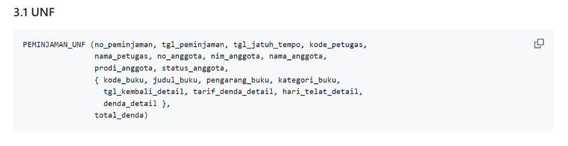
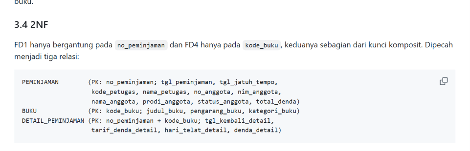
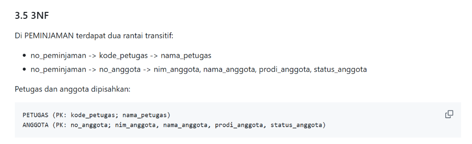

# Laporan Praktikum Basis Data - Pertemuan 04

**Nama      :Sabrina Raisya Putri****NIM       :25430041** **Kelas     :B** **Tanggal   :21 Oktober**

## 1. Tujuan Praktikum

Saya mempelajari cara menemukan anomali ubah, sisip, dan hapus pada data yang belum dinormalisasi. Saya menurunkan dependensi fungsional dari aturan bisnis, bukan dari contoh data. Saya menormalisasi relasi sampai 3NF dan memeriksa BCNF. Saya juga memutuskan apakah nilai turunan disimpan atau dihitung, lalu mendokumentasikan skema akhirnya.

## 2. Ringkasan Dasar Teori

Data yang disimpan berulang dalam satu tabel besar menimbulkan tiga anomali. Anomali ubah terjadi ketika satu fakta tertulis di banyak baris dan bisa tidak konsisten. Anomali sisip terjadi ketika suatu fakta tidak bisa dicatat sebelum fakta lain ada. Anomali hapus terjadi ketika menghapus satu fakta ikut menghapus fakta lain.

Dependensi fungsional A → B berarti setiap nilai A menentukan tepat satu nilai B. Dependensi ini diturunkan dari aturan bisnis, karena contoh data hanya dapat membantahnya, tidak membuktikannya.

Normalisasi berjalan bertahap:
- **1NF:** semua nilai atomik dan tidak ada grup berulang.
- **2NF:** tidak ada atribut bukan kunci yang bergantung pada sebagian kunci komposit.
- **3NF:** tidak ada ketergantungan transitif antar atribut bukan kunci.
- **BCNF:** setiap penentu adalah kunci kandidat.

Tujuan normalisasi adalah menghilangkan anomali, bukan memperbanyak tabel.

## 3. Hasil Langkah Percobaan

### 3.1 UNF → 1NF

```
NOTA_UNF (no_nota_penjualan, tgl_penjualan, kode_petugas, nama_petugas,
          no_anggota, nama_anggota,
          { kode_barang, nama_barang, qty_detail_penjualan,
            harga_satuan_detail_penjualan, subtotal_detail_penjualan },
          jumlah_penjualan, diskon_penjualan, total_penjualan)
```

Grup berulang (barang per nota) dipecah menjadi satu baris per barang per nota. Kunci primer menjadi komposit (no_nota_penjualan, kode_barang).

```
NOTA_1NF (no_nota_penjualan, kode_barang, tgl_penjualan, kode_petugas,
          nama_petugas, no_anggota, nama_anggota, nama_barang,
          qty_detail_penjualan, harga_satuan_detail_penjualan,
          subtotal_detail_penjualan, jumlah_penjualan, diskon_penjualan,
          total_penjualan)
```

### 3.2 Dependensi Fungsional (diturunkan dari aturan bisnis)

| FD | Dependensi | Dasar |
|---|---|---|
| FD1 | no_nota_penjualan → tgl_penjualan, kode_petugas, no_anggota | AB-01 |
| FD2 | kode_petugas → nama_petugas | satu kode satu petugas |
| FD3 | no_anggota → nama_anggota | AB-05 |
| FD4 | kode_barang → nama_barang | satu kode satu barang |
| FD5 | (no_nota_penjualan, kode_barang) → qty_detail_penjualan, harga_satuan_detail_penjualan | AB-04 |
| FD6 | qty_detail_penjualan, harga_satuan_detail_penjualan → subtotal_detail_penjualan | turunan |

### 3.3 Menuju 2NF dan 3NF

- **2NF:** FD1 dan FD4 hanya bergantung pada sebagian kunci komposit. Relasi dipisah menjadi `penjualan` (kunci no_nota_penjualan), `barang` (kunci kode_barang), dan `detail_penjualan` sebagai sisanya.
- **3NF:** di relasi penjualan ada rantai no_nota_penjualan → kode_petugas → nama_petugas dan no_nota_penjualan → no_anggota → nama_anggota. Relasi `petugas` dan `anggota` dipisah.
- **Nilai turunan:** subtotal_detail_penjualan, jumlah_penjualan, diskon_penjualan, dan total_penjualan tidak disimpan di tabel operasional. Semuanya dihitung dari detail dan status anggota, sehingga tidak mungkin tidak konsisten.

```
PENJUALAN (no_nota_penjualan, tgl_penjualan, kode_petugas*, no_anggota*, bayar_penjualan)
DETAIL_PENJUALAN (no_nota_penjualan*, kode_barang*, qty_detail_penjualan, harga_satuan_detail_penjualan)
BARANG (kode_barang, nama_barang, kategori_barang, harga_jual_barang, stok_barang, stok_min_barang)
PETUGAS (kode_petugas, nama_petugas, peran_petugas)
ANGGOTA (no_anggota, nim_anggota, nama_anggota, prodi_anggota, no_hp_anggota, status_anggota, tgl_daftar_anggota)
-- garis bawah = kunci primer, * = kunci tamu
```

### 3.4 Pencocokan dengan Skema Kanonik dan Pemeriksaan BCNF

Perbedaan utama dengan skema kanonik (Tabel 4.2) adalah kunci pengganti `id_*` sebagai kunci primer. Kode alami seperti no_nota_penjualan menjadi kunci unik.

| Tabel | Kunci primer | Kunci unik | Kunci tamu | Penentu bukan kunci kandidat? | BCNF |
|---|---|---|---|---|---|
| petugas | id_petugas | kode_petugas | – | Tidak ada | Ya |
| anggota | id_anggota | no_anggota, nim_anggota | – | Tidak ada | Ya |
| barang | id_barang | kode_barang | – | Tidak ada | Ya |
| pemasok | id_pemasok | – | – | Tidak ada | Ya |
| penjualan | id_penjualan | no_nota_penjualan | id_petugas, id_anggota (boleh NULL) | Tidak ada | Ya |
| detail_penjualan | (id_penjualan, id_barang) | – | id_penjualan, id_barang | Tidak ada | Ya |
| pembelian | id_pembelian | – | id_pemasok | Tidak ada | Ya |
| detail_pembelian | (id_pembelian, id_barang) | – | id_pembelian, id_barang | Tidak ada | Ya |

Hasil normalisasi Kopma lengkap ada di berkas `p04_normalisasi_kopma_25430041.md`. Tangkapan layar tahapan normalisasi proyek ada di bagian 6.

## 4. Jawaban Titik Analisis

**Titik Analisis 1.** FD5 menempatkan harga_satuan_detail_penjualan pada kunci (no_nota_penjualan, kode_barang) karena AB-04 menyatakan harga pada nota dapat berbeda dari harga barang saat ini. Satu barang bisa dijual dengan harga berbeda di nota berbeda, jadi kode_barang saja tidak menentukan harga satuan di nota. Jika kolom ini dipindah ke tabel barang, setiap kenaikan harga akan mengubah nilai seluruh nota lama. Laporan omzet tahun lalu akan terhitung ulang dengan harga hari ini dan hasilnya salah. Contohnya, nota pulpen sebelum 15 Oktober 2026 seharusnya tetap Rp4.000, bukan Rp4.500.

**Titik Analisis 2.** Pada tabel operasional, total tidak disimpan karena nilainya dapat dihitung ulang, sehingga tidak ada risiko total berbeda dari rinciannya. Data operasional juga masih dapat berubah, misalnya detail dikoreksi atau status diskon anggota berubah. Pada tabel arsip penjualan di Buku 2, total disimpan karena arsip adalah potret historis yang tidak boleh berubah. Tidak ada operasi ubah yang membuat total tidak sinkron, sehingga tidak ada anomali ubah, dan total tersimpan mempercepat pembacaan laporan. Kedua keputusan konsisten karena memakai satu kriteria: nilai turunan hanya disimpan jika tidak dapat menimbulkan anomali ubah.

**Titik Analisis 3.** Informasi "barang ini dipasok oleh siapa" kini tersimpan lewat riwayat pembelian: `pembelian` menyimpan id_pemasok, dan `detail_pembelian` menghubungkan pembelian itu dengan id_barang. Keuntungannya dibanding satu nama pemasok di tabel barang:
- Satu barang dapat dipasok beberapa pemasok.
- Kopma dapat berganti pemasok tanpa mengubah data barang.
- Riwayat siapa memasok apa, kapan, dan dengan harga berapa tetap tercatat.
- Nama pemasok tidak berulang di banyak baris barang, sehingga tidak ada anomali ubah ejaan.

## 5. Hasil Latihan dan Modifikasi

### Latihan 1: Beberapa nomor telepon per pemasok

Kolom `telepon_pemasok` yang menampung banyak nomor melanggar 1NF karena nilainya tidak atomik. Solusinya relasi baru dan kolom lama dihapus dari `pemasok`.

```
PEMASOK (id_pemasok, nama_pemasok, alamat_pemasok)
TELEPON_PEMASOK (id_pemasok*, nomor_telepon_pemasok, keterangan_telepon_pemasok)
-- kunci primer komposit (id_pemasok, nomor_telepon_pemasok)
```

Relasinya satu pemasok memiliki nol atau banyak nomor telepon. Skema ini memenuhi 3NF dan BCNF karena satu-satunya penentu adalah kunci primer komposit.

### Latihan 2: Pelanggaran 3NF dan anomali ubah

Jika nama_anggota disimpan di tabel penjualan, terbentuk rantai no_nota_penjualan → no_anggota → nama_anggota, yaitu ketergantungan transitif. Contoh data:

| no_nota_penjualan | no_anggota | nama_anggota |
|---|---|---|
| PJ-2609-0001 | A-0457 | Nadia Putri |
| PJ-2609-0010 | A-0457 | Nadia Putri |
| PJ-2609-0023 | A-0457 | Nadia Putri |

Anomali ubah muncul ketika nama dikoreksi hanya pada satu baris:

```sql
UPDATE penjualan_tidak_normal
SET nama_anggota = 'Nadia Putri Ayu'
WHERE no_nota_penjualan = 'PJ-2609-0001';
```

Setelah perintah ini, anggota A-0457 punya dua nama berbeda di tabel yang sama. Pada skema ternormalisasi cukup satu `UPDATE anggota ... WHERE no_anggota = 'A-0457'`.

## 6. Tugas Mandiri: Milestone Proyek 04

> **Bagian ini wajib dikerjakan sendiri.** Isi dari dokumen proyek Anda, bukan dari contoh Kopma di atas.

- Tema proyek: Klinik (dua digit akhir NIM: 41, rentang 25-49)
- Organisasi fiktif: [nama organisasi memuat inisial Anda]
- Dokumen sumber yang dipakai sebagai UNF: [sebutkan dokumen dari Pertemuan 2]
- Berkas: [`p04_normalisasi_25430041.md`](../p04_normalisasi_25430041.md)

**Bukti tangkapan layar tahapan normalisasi proyek**

UNF:



1NF:


2NF:



3NF:



[Tambahkan keterangan singkat di bawah setiap gambar: apa yang berubah dari tahap sebelumnya.]

| Tahap | Ringkasan hasil |
|---|---|
| UNF | [relasi UNF dokumen sumber Anda] |
| 1NF | [relasi dan kunci komposit] |
| 2NF | [relasi hasil pemisahan] |
| 3NF | [relasi akhir] |
| BCNF | [hasil pemeriksaan setiap tabel] |

Daftar dependensi fungsional beserta kode AB yang mendasarinya:

| FD | Dependensi | AB |
|---|---|---|
| FD1 | [..] | AB-[..] |

Keputusan nilai turunan:

| Nilai turunan | Disimpan / dihitung | Alasan |
|---|---|---|
| [..] | [..] | [..] |

Perubahan ERD proyek: [tulis perubahan, atau "tidak ada"].

## 7. Pembahasan dan Kendala

[Tulis dengan bahasa sendiri: kesulitan yang ditemui, misalnya saat menurunkan FD atau memutuskan nilai turunan, dan cara mengatasinya. Hubungkan dengan Masalah 1-3 pada bagian Troubleshooting Modul 4: dependensi disimpulkan dari contoh data, tabel terpecah berlebihan, dan kunci pengganti dianggap menyelesaikan normalisasi.]

## 8. Kesimpulan

[Dua sampai empat kalimat dengan bahasa sendiri. Contoh arah: normalisasi menghilangkan anomali ubah, sisip, dan hapus; FD harus berasal dari aturan bisnis; nilai turunan disimpan hanya jika tidak menimbulkan anomali.]

## 9. Pernyataan Penggunaan AI

Alat: [Claude / tidak menggunakan]. Untuk: [mis. membantu menyusun kerangka laporan dan menjelaskan konsep]. Bagian yang terbantu: [sebutkan bagian]. [Tulis "tidak menggunakan" bila tidak memakai AI.]

## 10. Bukti Git

- Repositori: https://github.com/[akun]/basisdata-25430041
- Commit Pertemuan 4 (`p04: normalisasi kopma`): [hash]
- Commit milestone proyek: [hash]

## Checklist (salin dari buku, centang)

**Umum**
- [ ] Identitas
- [ ] Tujuan (maks. 5 baris)
- [ ] Ringkasan teori (maks. setengah halaman)
- [ ] Langkah percobaan (D) dengan tangkapan layar
- [ ] Titik Analisis 1-3 dijawab dengan alasan
- [ ] Latihan (E) beserta bukti
- [ ] Tugas Mandiri (F)
- [ ] Pembahasan dan kendala
- [ ] Kesimpulan
- [ ] Pernyataan Penggunaan AI
- [ ] Bukti Git
- [ ] Keaslian (tangkapan layar menampilkan akun ber-NIM dan jam sistem)

**Khusus Pertemuan 4**
- [ ] Berkas wajib: `p04_normalisasi_25430041.md` (proyek)
- [ ] Bukti tangkapan layar: tabel tahapan UNF → 1NF → 2NF → 3NF (`p04_ss_unf_proyek.png`, `p04_ss_1nf_proyek.png`, `p04_ss_2nf_proyek.png`, `p04_ss_3nf_proyek.png`)
- [ ] Analisis wajib: daftar dependensi fungsional; keputusan menyimpan atau menghitung nilai turunan beserta alasannya