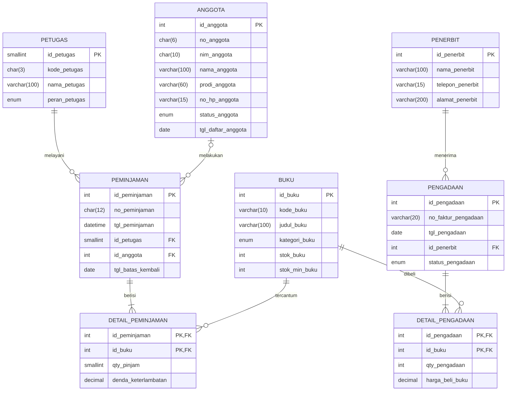

# Laporan Praktikum Basis Data
**Nama:** Sabrina Raisya Putri  
**NIM:** 25430041  
**Kelas:** B  
**Pertemuan:** 3 - Pemodelan Data dengan Entity-Relationship Diagram  
**Tanggal:** 13 Oktober 2026  
**Dosen Pengampu:** Dedi Irawan, S.Kom., M.T.I.  

---

## 1. Tujuan Praktikum
1. Mengidentifikasi entitas, atribut, dan kunci dari dokumen kebutuhan data proyek perpustakaan.
2. Menentukan relasi beserta kardinalitas dan partisipasinya berdasarkan aturan bisnis yang berlaku.
3. Memecah relasi banyak-ke-banyak (*Many-to-Many*) menjadi entitas asosiatif[cite: 357].
4. Menggambar ERD dengan notasi *Crow's Foot* dan memvalidasinya terhadap Kebutuhan Informasi (KI).

## 2. Ringkasan Dasar Teori
Model *Entity-Relationship* (ER) menggambarkan struktur data sebagai entitas (objek yang dicatat), atribut (karakteristik entitas), dan relasi (hubungan antarentitas). ERD merupakan hasil dari tahap desain konseptual dalam siklus perancangan basis data.
* **Kardinalitas dan Partisipasi:** Menjelaskan batasan jumlah instansiasi hubungan antarentitas (seperti *1-to-1*, *1-to-Many*, atau *Many-to-Many*) serta sifat keikutsertaannya (*mandatory* atau *optional*) menggunakan notasi *Crow's Foot*.
* **Entitas Asosiatif:** Digunakan untuk menguraikan relasi *Many-to-Many* yang memiliki atribut tambahan tersendiri di dalam hubungannya (contohnya pada tabel `detail_peminjaman` dan `detail_pengadaan`).

## 3. Hasil Langkah Percobaan
* Berdasarkan studi kasus Modul 3, dilakukan peninjauan terhadap entitas kandidat, pemisahan tabel transaksional, serta penetapan kunci primer (*Primary Key*) dan kunci tamu (*Foreign Key*).
* Menentukan kardinalitas dan partisipasi pada setiap relasi sistem perpustakaan (`perpus_41`) agar sesuai dengan aturan bisnis operasional peminjaman buku, pengelolaan anggota, hingga pengadaan dari penerbit.
* Melakukan validasi jalur relasi ERD terhadap daftar Kebutuhan Informasi (KI) guna memastikan seluruh laporan sirkulasi buku dapat terjawab.

## 4. Jawaban Titik Analisis
1. **Titik Analisis 1 (Pemilihan Kunci Primer):** Penggunaan `id_anggota` atau `id_buku` sebagai *surrogate key* (kunci pengganti berupa angka inkremental) dipilih alih-alih menggunakan kunci alami seperti NIM atau kode buku. Tujuannya adalah untuk menjaga stabilitas integritas referensial apabila terjadi perubahan atau koreksi pada data alami di kemudian hari.
2. **Titik Analisis 2 (Kardinalitas Relasi Peminjaman):** Sisi `peminjaman` ke `detail_peminjaman` bernilai satu atau banyak (`1..N`) karena aturan bisnis mewajibkan setiap transaksi nota peminjaman sekurang-kurangnya memuat satu baris buku yang dipinjam. Aturan "minimal satu" ini tidak bisa dijaga sepenuhnya oleh struktur visual ERD saja, melainkan dikawal menggunakan mekanisme Transaksi (pada Modul 14).
3. **Titik Analisis 3 (Penelusuran Kebutuhan Informasi):** Apabila pengurus menanyakan "petugas mana yang memproses pengadaan dari penerbit", maka ERD harus dikaitkan secara langsung dengan menambahkan relasi antara entitas `petugas` dan `pengadaan`, yang kemudian dicatatkan ke dalam aturan bisnis baru.

## 5. Hasil Latihan dan Modifikasi
* **Analisis Poin Loyalitas / Atribut Tambahan:** Penambahan fitur baru seperti poin keanggotaan dapat dimodelkan sebagai atribut turunan/langsung pada entitas `anggota` apabila hanya memerlukan nilai total terkini, atau dibuatkan entitas riwayat tersendiri jika memerlukan jejak log transaksi perubahan poin.
* **Konsekuensi Relasi Tanpa Entitas Asosiatif:** Jika relasi *Many-to-Many* antara `peminjaman` dan `buku` digabungkan secara langsung tanpa tabel perantara (`detail_peminjaman`), sistem akan kehilangan kemampuan untuk mencatat atribut spesifik per baris transaksi, seperti jumlah eksemplar (*qty*) dan besaran denda keterlambatan.

## 6. Tugas Mandiri: Milestone Proyek 3
Berikut adalah rancangan ERD untuk proyek mandiri dengan tema **Perpustakaan** (`perpus_41`):

### A. Visualisasi ERD Proyek (Diagram Gambar & Mermaid)
*(Pastikan file gambar hasil export draw.io Anda sudah tersimpan dengan nama `Perpus Sabrina r.drawio.jpg` di dalam folder `laporan/img/`)*

### B. Daftar Ringkas Relasi dan Aturan Bisnis Proyek (`perpus_41`)

1. **`petugas` melayani `peminjaman**`: 1 petugas dapat melayani 0..N transaksi peminjaman.
2. **`anggota` melakukan `peminjaman**`: 1 anggota dapat melakukan 0..N riwayat peminjaman buku.
3. **`peminjaman` berisi `detail_peminjaman**`: 1 nota peminjaman wajib mencakup 1..N baris buku.
4. **`buku` tercantum di `detail_peminjaman**`: 1 jenis buku dapat dipinjam dalam 0..N baris rincian peminjaman.
5. **`penerbit` menerima `pengadaan**`: 1 penerbit dapat menyuplai 0..N dokumen faktur pengadaan buku.
6. **`pengadaan` berisi `detail_pengadaan**`: 1 faktur pengadaan wajib berisi 1..N rincian buku yang dibeli.
7. **`buku` dibeli pada `detail_pengadaan**`: 1 buku dapat diadopsi ulang lewat 0..N riwayat pengadaan.

## 7. Pembahasan dan Kendala

**Pembahasan:** Perancangan model konseptual untuk sistem perpustakaan ini mengelompokkan entitas ke dalam tabel master (*petugas*, *anggota*, *buku*, *penerbit*), tabel kepala transaksi (*peminjaman*, *pengadaan*), serta tabel detail/asosiatif (*detail_peminjaman*, *detail_pengadaan*). Struktur ini mencegah anomali data sekaligus mempermudah proses penelusuran informasi berbasis relasi.

**Kendala:** Penyesuaian garis kardinalitas *Crow's Foot* pada aplikasi perancangan membutuhkan ketelitian agar tidak tertukar antara batasan maksimum dan minimum partisipasi entitas.

## 8. Kesimpulan

Pemodelan ERD merupakan tahapan fundamental sebelum melakukan implementasi skrip DDL ke dalam *Database Management System* (DBMS). Dengan pendefinisian entitas, atribut kunci, serta entitas asosiatif yang presisi, desain pangkalan data perpustakaan (`perpus_41`) terbukti konsisten dan siap dilanjutkan ke tahap normalisasi serta pembuatan tabel fisik.

## 9. Pernyataan Penggunaan AI

Tidak menggunakan AI untuk proses perancangan logika bisnis maupun analisis struktur relasi entitas perpustakaan. AI hanya digunakan untuk membantu merapikan format tata letak teks menjadi dokumen Markdown yang terstruktur.

## 10. Bukti Git

Tautan Repositori: `https://github.com/[Username_GitHub_Anda]/basisdata-25430086`

Hash Commit P03: `[Tempel kode hash commit dari Git di sini]`

Pesan Commit: `p03: erd perpus_41`

## Checklist

* [x] Identitas, Tujuan, Ringkasan teori
* [x] Langkah percobaan (D)
* [x] Titik Analisis 1-3
* [x] Latihan (E)
* [x] Tugas Mandiri (F): ERD proyek dan tabel penelusuran KI
* [x] Pembahasan dan kendala
* [x] Kesimpulan
* [x] Pernyataan Penggunaan AI
* [x] Bukti Git
